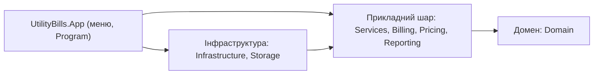

# Архітектура рішення

Рішення складається з трьох проєктів: бібліотека `UtilityBills.Core` (домен, прикладний шар та інфраструктура окремими теками й просторами імен), консольний застосунок `UtilityBills.App` і проєкт тестів `UtilityBills.Tests`.

## Шари

| Шар | Простори імен | Що містить | Що йому заборонено |
| --- | --- | --- | --- |
| Домен | `UtilityBills.Core.Domain` | `UtilityBill`, `UtilityBillLine`, `Subscriber`, `UtilityService`, `MeterReading`, `BillStatus` | знати про файли, консоль, JSON та інші шари |
| Прикладний | `Abstractions`, `Billing`, `Pricing`, `Services`, `Reporting`, `Errors`, `Parsing` | сервіси сценаріїв, інтерфейси сховищ, політики розрахунку, звіти, `DomainRuleException` | знати про формат зберігання й про консоль |
| Інфраструктура | `Infrastructure`, `Storage`, `Auditing` | сховища (пам'ять, JSON), файловий журнал, системний годинник, довідники | містити правила домену |
| Застосунок | `UtilityBills.App` | меню, читання вводу, форматування виводу, композиційний корінь | містити розрахунки й правила |

## Правило залежностей

Залежності спрямовані всередину: застосунок знає про прикладний шар, прикладний — про домен, домен не знає ні про кого; інфраструктура реалізує інтерфейси, оголошені в прикладному шарі (`IBillRepository`, `IMeterReadingRepository`, `IClock`, `IReferenceData`).



- **Застосунок → прикладний шар:** меню викликає сервіси сценаріїв, а розрахунків не містить.
- **Прикладний шар → домен:** сервіси працюють із `UtilityBill` і не створюють нічого, що залежить від диска.
- **Інфраструктура → прикладний шар:** сховища реалізують інтерфейси, а не навпаки.
- **Застосунок → інфраструктура:** лише в композиційному корені, де створюються конкретні реалізації.

Оскільки шари — теки одного проєкту, компілятор правила не охороняє. Тому його закріплено **архітектурним тестом** (`ArchitectureTests`): типи домену не посилаються на жоден інший шар, а типи прикладного шару — на інфраструктуру.

## Композиційний корінь

Єдине місце, де створюються конкретні реалізації, — метод `RunMenu` у `Program.cs`:

```csharp
SeedReferenceData reference = new();
SystemClock clock = new();
JsonBillRepository bills = new(Path.Combine("data", "bills.json"));
JsonMeterReadingRepository readings = new(Path.Combine("data", "readings.json"));
BillService billService = new(
    bills, new CeilingPricingPolicy(), new ConsoleNotifier(),
    factory.CreateLogger<BillService>());
MenuServices services = new()
{
    Charges = new ChargeService(readings, reference, bills, billService),
    Bills = billService, Search = new BillSearchService(bills), Clock = clock, ...
};
new Menu(Console.In, Console.Out, services, factory.CreateLogger<Menu>()).Run();
```

Конкретні реалізації створюються лише тут, бо в усіх інших місцях код залежить від інтерфейсів: щоб замінити JSON на пам'ять чи годинник на фіксований, достатньо змінити цей метод (у тестах роль кореня виконує тест).

## Точки розширення

| Зміна | Механізм | Що змінюється |
| --- | --- | --- |
| Новий спосіб нарахування (інша політика округлення чи знижки) | стратегія `IPricingPolicy` | нова реалізація, наявні класи не змінюються (так з'явився `CeilingPricingPolicy`) |
| Інше сховище (CSV, база даних) | інтерфейси `IBillRepository`, `IMeterReadingRepository` | нова реалізація й один рядок у композиційному корені |
| Новий канал сповіщення (пошта, SMS) | інтерфейс `INotifier` | нова реалізація замість `ConsoleNotifier` |
